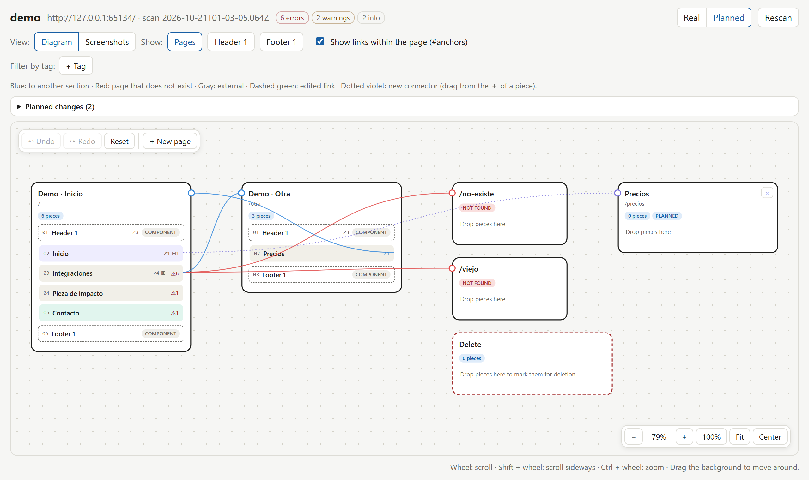

# Site Atlas

**A semantic map of websites for people and AI agents.**
Site Atlas scans a site, splits every page into **sections** (header, hero, content sections, footer…), flags problems, and lets you rearrange the site on a drag‑and‑drop **org chart**. Everything you plan is exposed through **MCP** and the **CLI**, so any AI (Claude, Codex, GPT and others) can read it and implement it in the code.



---

## Why it exists

Looking at a page doesn't answer questions like:

- Which sections does this page have, and in what order?
- Where does each button point, and which links are broken?
- Should this section live on another page?
- What changes if I move section A to page B?

Site Atlas makes that visible and turns your decisions into a **concrete plan** an AI can execute. Atlas never modifies the site itself: you decide, the AI implements.

## What it does

| | |
|---|---|
| **Section-level scanning** | Renders each page in Chromium, splits it into sections and records name, type (narrative, visual, conversion), headings, links, forms, media and a thumbnail. |
| **Issues** | Broken links, missing anchors, forms without an action, placeholder images, sections without an anchor, missing or duplicate headings, duplicate ids. |
| **Org chart** | Each page is a diagram of pieces, with **one line per link, drawn from the exact section that contains it**: blue to another section, red to a page that doesn't exist, gray to an external site. Shared components (header, footer) get their own diagram. Drag a piece to reorder it or move it to another page, drag a line's end to point it at a new target, drag from the `+` of a piece to add a connector, add planned pages, and undo or redo any of it. A **Screenshots** view swaps the diagram for the real thumbnails. Also: tags with filters, a trash zone, Real / Planned views and live updates. |
| **Plan for AI** | The differences between the real site and the plan, in plain language and JSON. Each change is **pending** until the AI that implements it confirms it (with a note), and then it is **applied**. |
| **Lossless re-scans** | Your organization survives site changes: sections are matched by anchor, fingerprint or text similarity, and anything unmatched becomes an orphan you can reassign. |
| **Local and safe** | Runs on your machine, the server listens on `127.0.0.1` only, protected against CSRF and DNS rebinding, no telemetry. Atlas never writes to your site's repository. |

## How it works

```
 your site (localhost, staging or production)
        │  Chromium scan (read-only)
        ▼
 ~/.site-atlas/sites/<site>/
   ├── scans/*.json      immutable snapshots of the site
   ├── shots/*.webp      a thumbnail per section
   └── overlay.json      your organization: order, pages, tags
        │
        ├──► local canvas   http://127.0.0.1:4800
        └──► MCP / CLI ──► Claude · Codex · GPT · …  ──► changes in the site's code
```

## Installation

Requirements: **Node 24+** and **pnpm** (`npm i -g pnpm`).

```bash
git clone https://github.com/zavants/site-atlas-zavants.git
cd site-atlas-zavants
pnpm install
pnpm exec playwright install chromium
pnpm build
```

## Quick start

```bash
# Scan (up to 30 pages by default)
node dist/cli.js scan http://localhost:4321/

# More options
node dist/cli.js scan https://example.com --max-pages 5 --exclude "/blog/**"

# Open the canvas
node dist/cli.js canvas
```

### CLI

| Command | Purpose |
|---|---|
| `scan <url>` · `canvas [site]` | Scan a site · open the canvas |
| `plan <site>` | Print the plan: pending and applied changes |
| `confirm <site> <changeId> --note "<what you changed and where>"` · `reopen <site> <changeId> --note "<why>"` | Mark a change applied once it is in the code · set it back to pending |
| `move <site> <blockKey> <toPage>` · `delete <site> <blockKey>` · `restore <site> <blockKey>` | Propose moving or deleting a section, or cancel the deletion |
| `page add <site> <path>` · `page remove <site> <path>` | Planned pages |
| `relink <site> <owner>` · `unlink <site> <owner>` · `link add <site> <owner>` · `link remove <site> <linkId>` | Change, remove, add or drop links |

An agent without MCP can work from the terminal alone: `site-atlas plan my-site`, implement the pending changes, then `site-atlas confirm my-site <changeId> --note "<what you changed and where>"`.

## Connect it to your AI (MCP)

The MCP server starts with `node <path>/dist/cli.js mcp` over stdio.

**Claude Code (terminal)**

```bash
claude mcp add site-atlas -- node /path/to/site-atlas-zavants/dist/cli.js mcp
```

**Claude Code (desktop app, without the `claude` CLI).** Add this to `~/.claude.json`, inside `mcpServers`:

```json
"site-atlas": { "type": "stdio", "command": "node", "args": ["/path/to/site-atlas-zavants/dist/cli.js", "mcp"] }
```

**Codex**, in `~/.codex/config.toml`:

```toml
[mcp_servers.site-atlas]
command = "node"
args = ["/path/to/site-atlas-zavants/dist/cli.js", "mcp"]
```

**Other MCP clients** (Cursor, Windsurf, Claude Desktop…):

```json
{ "mcpServers": { "site-atlas": { "command": "node", "args": ["/path/to/site-atlas-zavants/dist/cli.js", "mcp"] } } }
```

### Tools (20)

| Tool | Purpose |
|---|---|
| `atlas_scan` | Scan a site and reconcile your existing organization |
| `atlas_list_sites` | List scanned sites |
| `atlas_get_map` | Map of pages and sections, with tags and planned order |
| `atlas_get_block` | Section details (components, issues, thumbnail) |
| `atlas_list_issues` | Issues from the latest scan |
| `atlas_tags` · `atlas_set_block_tags` | Create, rename, delete and assign tags |
| `atlas_move_block` · `atlas_add_planned_page` | Rearrange the planned order |
| `atlas_get_plan` | The plan (Markdown + JSON, optional `status`): what to change in the site's code |
| `atlas_confirm_change` · `atlas_reopen_change` | Mark a change applied (with a note) or set it back to pending |
| `atlas_relink` · `atlas_unlink` · `atlas_add_link` · `atlas_remove_link` | Propose changing, removing or adding links, or drop a link proposal |
| `atlas_mark_deleted` · `atlas_restore` · `atlas_remove_planned_page` | Propose deleting a section, undo it, remove a planned page |
| `atlas_open_canvas` | Canvas URL |

Changes proposed on the canvas, by the CLI or by an agent stay **pending** in the plan. After implementing one in the code, the agent calls `atlas_confirm_change` (or `site-atlas confirm`) and the change moves to **applied**.

Example prompt for an agent:

> "Scan http://localhost:4321 with site-atlas, move the pricing section to /pricing and tell me what needs to change in the code."

Text extracted from the scanned site is marked as **untrusted content**, so agents treat it as data, not instructions.

## CLI on Windows (Git Bash)

Git Bash rewrites arguments that start with `/` into Windows paths (`/~hero` becomes `C:/Program Files/Git/~hero`) before the CLI sees them. Start the command with `MSYS_NO_PATHCONV=1`:

```sh
MSYS_NO_PATHCONV=1 site-atlas move my-site /~hero /pricing
```

The CLI refuses arguments that look rewritten and tells you to do this. PowerShell and cmd are not affected.

## Optional markers

Atlas detects sections on its own: top-level `header`, `section` and `footer`, plus visible blocks inside `main`. On your own site you can set the exact split:

```html
<section data-atlas-block="Hero">…</section>
```

## Data and privacy

- Everything is stored in `~/.site-atlas/`, or in the folder set by `SITE_ATLAS_HOME`.
- Nothing leaves your machine, except the requests to the site you scan.
- On public sites it respects `robots.txt` and waits 1 s between pages.
- Atlas **never writes** to the site's repository.

## Development

```bash
pnpm test            # unit, integration and canvas tests (Vitest + Playwright)
pnpm typecheck       # server (tsc) and canvas (vue-tsc)
pnpm atlas scan …    # CLI without building (tsx)
pnpm dev:canvas      # canvas with hot reload (needs the server on :4800)
```

Stack: Node 24, TypeScript, Playwright, Hono, Vue 3 + Vite, Zod and `@modelcontextprotocol/sdk`.

> The interface and messages are currently in Spanish.

## Tested with

| Site | Result |
|---|---|
| Local marketing site (HTML, 15 sections) | 15 sections with their real names; found a broken link, 4 sections without an anchor, placeholder images and a form without an action |
| stripe.com (1 page) | 10 sections, 8 with a readable name, in 26 s |
| vercel.com (1 page) | 6 sections, all with a readable name |
| Agent round trip (terminal-only Claude agent, CLI only, no MCP) | Read `site-atlas plan`, implemented a section delete and a relink in the site source, verified with curl, confirmed both with notes; after a re-scan the plan reports the site already matches it |

## Contributing

Issues and pull requests are welcome. For larger changes, please open an issue first to discuss them. Design decisions live in [`docs/superpowers/specs/`](docs/superpowers/specs/).

## License

Open source under the [MIT](LICENSE) license.
