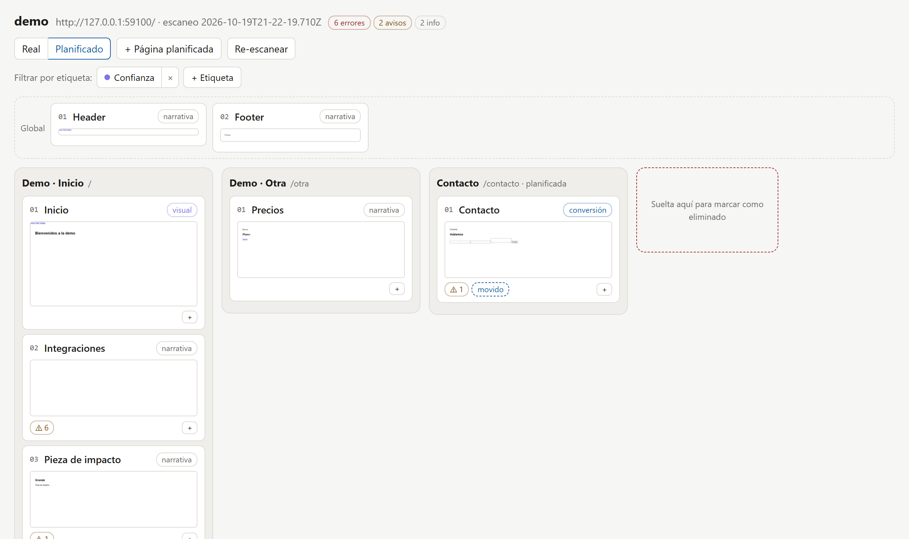

# Site Atlas

**Mapa semántico de sitios web para personas y agentes de IA.**
Site Atlas escanea un sitio, lo divide en **bloques** (header, hero, secciones, footer…), detecta problemas y te deja reorganizarlo en un lienzo con arrastrar y soltar. Todo lo que planificas se expone por **MCP** y por **terminal**, para que cualquier IA (Claude, Codex, GPT u otras) lo lea y lo implemente en el código.

> *English:* Site Atlas scans any website into sections, flags broken links and placeholders, lets you rearrange it on a drag‑and‑drop canvas, and exposes the resulting plan to any AI agent through MCP or the CLI. Local‑first, open source (MIT).



---

## Por qué existe

Mirar una página no responde preguntas como:

- ¿Qué secciones tiene esta página y en qué orden?
- ¿A dónde apunta cada botón y qué enlaces están rotos?
- ¿Esta sección debería vivir en otra página?
- ¿Qué cambia si muevo la sección A a la página B?

Site Atlas lo hace visible y convierte tus decisiones en un **plan concreto** que una IA puede ejecutar. El sitio no se modifica nunca desde Atlas: tú decides y la IA implementa.

## Qué hace hoy (v1)

| | |
|---|---|
| **Escaneo por bloques** | Renderiza cada página en Chromium, la divide en bloques y guarda nombre, tipo (narrativa, visual, conversión), títulos, enlaces, formularios, medios y una miniatura. |
| **Alertas** | Enlaces rotos, anclas inexistentes, formularios sin destino, imágenes provisionales, secciones sin ancla, títulos faltantes o duplicados, ids repetidos. |
| **Lienzo** | Columnas por página, carril de componentes globales, arrastrar para reordenar o mover entre páginas, páginas planificadas, etiquetas con filtro, papelera, vista Real o Planificado y actualización en vivo. |
| **Plan para IA** | Las diferencias entre el sitio real y lo planificado, en lenguaje claro y en JSON. |
| **Re-escaneo sin pérdidas** | Lo que organizaste sobrevive a los cambios del sitio: los bloques se reconocen por ancla, huella o similitud de texto, y lo que no se reconoce queda como huérfano para reasignarlo. |
| **Seguro y local** | Todo corre en tu máquina, el servidor escucha solo en `127.0.0.1`, protegido contra CSRF y DNS rebinding, sin telemetría. Atlas no escribe nada en el repositorio de tu sitio. |

### En camino (v2): el organigrama

Cada página como un diagrama de piezas, con **una línea por enlace saliendo de la sección exacta que lo contiene**. Incluye componentes compartidos con su propio diagrama, flechas que se arrastran e imantan, conectores nuevos, una vista con capturas ampliadas, y cambios que quedan **pendientes hasta que una IA confirma** que los aplicó. Diseño en revisión: [`organigrama-design.md`](https://github.com/zavants/site-atlas-zavants/blob/docs/organigrama-v2/docs/superpowers/specs/2026-10-19-organigrama-design.md).

## Cómo funciona

```
 tu sitio (localhost, staging o producción)
        │  escaneo con Chromium (solo lectura)
        ▼
 ~/.site-atlas/sites/<sitio>/
   ├── scans/*.json      fotografías inmutables del sitio
   ├── shots/*.webp      miniaturas de cada bloque
   └── overlay.json      tu organización: orden, páginas, etiquetas
        │
        ├──► lienzo local   http://127.0.0.1:4800
        └──► MCP / terminal ──► Claude · Codex · GPT · …  ──► cambios en el código del sitio
```

## Instalación

Requisitos: **Node 24+** y **pnpm** (`npm i -g pnpm`).

```bash
git clone https://github.com/zavants/site-atlas-zavants.git
cd site-atlas-zavants
pnpm install
pnpm exec playwright install chromium
pnpm build
```

## Uso rápido

```bash
# Escanear (máximo 30 páginas por defecto)
node dist/cli.js scan http://localhost:4321/

# Más opciones
node dist/cli.js scan https://ejemplo.com --max-pages 5 --exclude "/blog/**"

# Abrir el lienzo
node dist/cli.js canvas
```

## Conectarlo a tu IA (MCP)

El servidor MCP se inicia con `node <ruta>/dist/cli.js mcp`, por stdio.

**Claude Code (terminal)**

```bash
claude mcp add site-atlas -- node /ruta/a/site-atlas-zavants/dist/cli.js mcp
```

**Claude Code (app de escritorio, sin la CLI `claude`).** Agrega esto en `~/.claude.json`, dentro de `mcpServers`:

```json
"site-atlas": { "type": "stdio", "command": "node", "args": ["/ruta/a/site-atlas-zavants/dist/cli.js", "mcp"] }
```

**Codex**, en `~/.codex/config.toml`:

```toml
[mcp_servers.site-atlas]
command = "node"
args = ["/ruta/a/site-atlas-zavants/dist/cli.js", "mcp"]
```

**Otros clientes MCP** (Cursor, Windsurf, Claude Desktop…):

```json
{ "mcpServers": { "site-atlas": { "command": "node", "args": ["/ruta/a/site-atlas-zavants/dist/cli.js", "mcp"] } } }
```

### Herramientas

| Herramienta | Para qué |
|---|---|
| `atlas_scan` | Escanear un sitio y conciliar lo ya organizado |
| `atlas_list_sites` | Ver los sitios escaneados |
| `atlas_get_map` | Mapa por páginas y bloques, con etiquetas y orden planificado |
| `atlas_get_block` | Detalle de un bloque (componentes, alertas, miniatura) |
| `atlas_list_issues` | Alertas del último escaneo |
| `atlas_tags` · `atlas_set_block_tags` | Crear, renombrar, borrar y asignar etiquetas |
| `atlas_move_block` · `atlas_add_planned_page` | Reorganizar el orden planificado |
| `atlas_get_plan` | Diferencias entre el sitio real y el plan, listas para implementar |
| `atlas_open_canvas` | URL del lienzo |

Ejemplo de conversación con un agente:

> "Escanea http://localhost:4321 con site-atlas, mueve la sección de precios a /precios y dime qué cambios hay que hacer en el código."

El texto que viene del sitio escaneado se marca como **contenido no confiable**, para que el agente lo trate como datos y no como instrucciones.

## Marcas opcionales

Atlas detecta los bloques solo: `header`, `section` de primer nivel, `footer` y bloques visibles de `main`. En un sitio propio puedes fijar la división exacta:

```html
<section data-atlas-block="Hero">…</section>
```

## Datos y privacidad

- Todo se guarda en `~/.site-atlas/`, o en la carpeta que indique `SITE_ATLAS_HOME`.
- Nada sale de tu máquina, salvo las visitas al sitio que escaneas.
- En sitios públicos respeta `robots.txt` y espera 1 s entre páginas.
- Atlas **nunca escribe** en el repositorio del sitio.

## Desarrollo

```bash
pnpm test            # pruebas unitarias, de integración y del lienzo (Vitest + Playwright)
pnpm typecheck       # servidor (tsc) y lienzo (vue-tsc)
pnpm atlas scan …    # CLI sin compilar (tsx)
pnpm dev:canvas      # lienzo con recarga en vivo (requiere el servidor en :4800)
```

Stack: Node 24, TypeScript, Playwright, Hono, Vue 3 + Vite, Zod y `@modelcontextprotocol/sdk`.

## Probado con

| Sitio | Resultado |
|---|---|
| Sitio de marketing local (HTML, 15 secciones) | 15 bloques con sus nombres reales; detectó un enlace roto, 4 secciones sin ancla, imágenes provisionales y un formulario sin destino |
| stripe.com (1 página) | 10 bloques, 8 con nombre legible, en 26 s |
| vercel.com (1 página) | 6 bloques, todos con nombre legible |

## Contribuir

Los issues y pull requests son bienvenidos. Antes de cambios grandes, abre un issue para conversarlo. Las decisiones de diseño viven en [`docs/superpowers/specs/`](docs/superpowers/specs/).

## Licencia

Código abierto bajo licencia [MIT](LICENSE).
